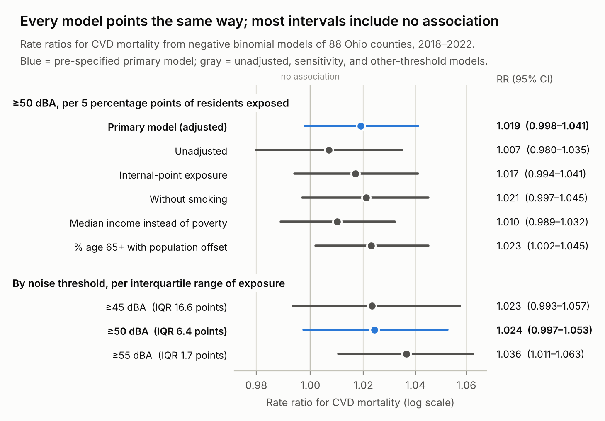
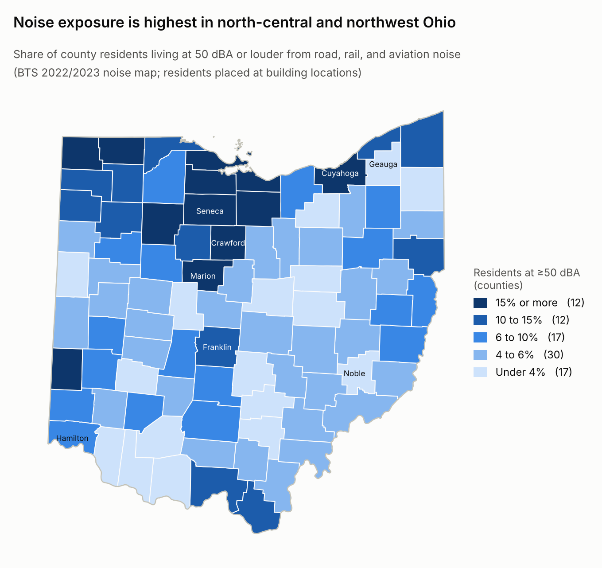
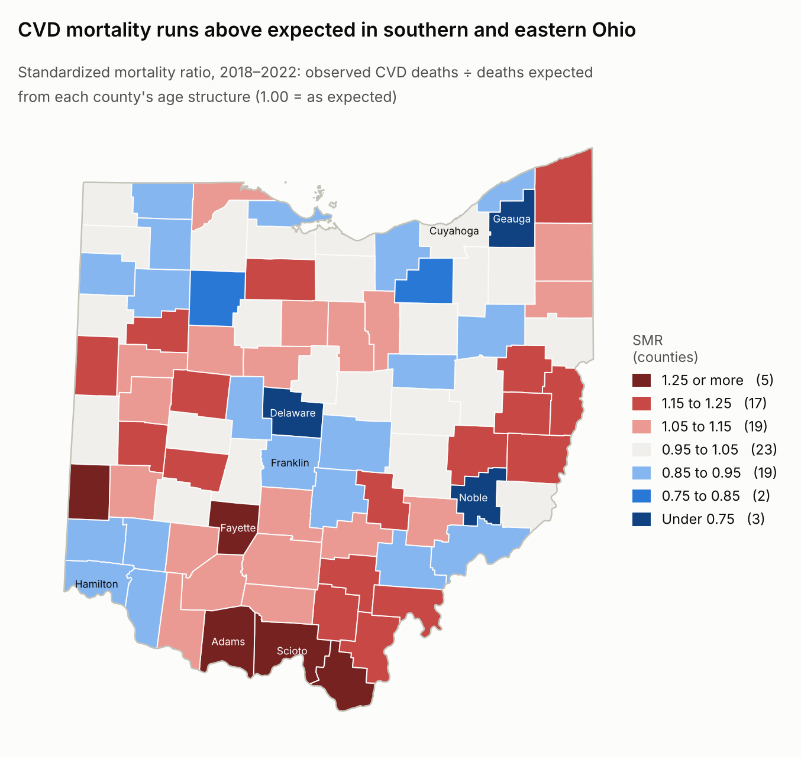

# Transportation noise and cardiovascular mortality in Ohio counties

An independent research project testing whether the link between long-term noise exposure and cardiovascular disease (CVD) mortality, reported from restricted individual-level death records by [Jin et al. (2024)](https://doi.org/10.1016/j.envres.2023.118092), can be seen using only public data.

**Main result:** Across Ohio's 88 counties (198,052 CVD deaths, 2018–2022), each additional 5 percentage points of residents living at ≥50 dBA of transportation noise was associated with 1.9% higher age-adjusted CVD mortality (rate ratio 1.019, 95% CI 0.998–1.041). The direction was the same in every model; most confidence intervals include no association.



The full write-up is in [`report/noise_cvd_report.md`](report/noise_cvd_report.md).

## What the project found

- **A positive but imprecise association with mortality.** The estimate stayed between 1.007 and 1.023 across the unadjusted model and four sensitivity analyses. It was somewhat larger at the ≥55 dBA threshold (per interquartile range: 1.036, 95% CI 1.011–1.063).
- **Where residents are placed matters for exposure.** Assigning each census block's population to one point undercounted exposure in exurban counties (Geauga: 0.1% of residents at ≥45 dBA, against about 6% of its land). Placing residents at 5.3 million building locations raised exposure in every county while leaving county rankings nearly unchanged (Spearman ρ = 0.96 at ≥50 dBA).
- **The most exposed counties are small rail-junction counties** in north-central Ohio (Seneca, Crawford, Marion), not the largest cities.
- **Ignoring overdispersion would have produced a false "significant" result.** A Poisson model gave p = 0.001; county death counts vary about 15 times more than Poisson assumes, and the negative binomial model gives p = 0.074.
- **Model-based prevalence data could not test the question.** CDC PLACES coronary heart disease prevalence showed no association (prevalence ratio 1.002, 95% CI 0.998–1.005), but the covariates alone explain 97.5% of its variation, which leaves little room to detect an exposure PLACES was not modeled from.

| Noise exposure | CVD mortality |
|---|---|
|  |  |

## Repository layout

```
noise-cvd/
├── notebooks/                       analysis, run in numbered order
├── data/
│   ├── raw/                         small source files, kept as downloaded
│   ├── processed/                   county-level tables produced by the notebooks
│   └── large/                       large downloads, not in the repository (see data/README.md)
├── outputs/                         figures and results tables
├── report/                          written report
├── Noise_CVD_Data_Inventory.xlsx    data inventory and decision log
└── requirements.txt
```

## Notebooks

| Notebook | What it does | Main output |
|---|---|---|
| `01_wonder_suppression` | Checks whether CDC WONDER suppresses county CVD death counts in Ohio (it does not, at these levels of detail) | — |
| `02_places_morbidity` | Loads CDC PLACES age-adjusted CHD, stroke, and high blood pressure prevalence | `places_oh_county_ageadj.csv` |
| `03_noise_exposure` | Noise exposure with residents placed at census block internal points; diagnoses why this undercounts exurban counties | `noise_oh_county_2022.csv` |
| `04_building_weighted_exposure` | Noise exposure with residents placed at building locations (primary exposure) | `noise_oh_county_2022_bldg.csv` |
| `05_county_covariates` | Urbanicity, ACS demographics and poverty, smoking | `covariates_oh_county.csv` |
| `06_PM2.5` | Population-weighted PM2.5, 2018–2022 | `pm25_oh_county.csv` |
| `07_model` | Expected deaths, negative binomial models, sensitivity analyses, spatial autocorrelation | `analysis_oh_county.csv`, `nb_results_noise.csv` |
| `08_chd_prevalence` | Secondary outcome: CHD prevalence | `ols_results_chd.csv` |
| `09_figures` | Figures and the descriptive table for this README and the report | `outputs/fig*.png` |

Each notebook starts with its question, data, and method, and ends with an interpretation of its results.

## Data sources

| Data | Source | Years |
|---|---|---|
| CVD deaths (ICD-10 I00–I99) | CDC WONDER, Underlying Cause of Death (Single Race) | 2018–2022 |
| Transportation noise | BTS National Transportation Noise Map (road, rail, aviation; 30 m) | 2022/2023 |
| Population by census block | 2020 Census, TIGER/Line block file | 2020 |
| Building locations | Microsoft US Building Footprints | imagery dates vary |
| Demographics, poverty, age structure | American Community Survey 5-year estimates | 2018–2022 |
| CHD prevalence, smoking | CDC PLACES, 2025 release | mostly 2023 |
| PM2.5 | Washington University ACAG, V6.GL.02.04 | 2018–2022 |
| County boundaries | Census cartographic boundary files | 2022 |

The data inventory (`Noise_CVD_Data_Inventory.xlsx`) lists every source considered, including those not used, and its Decision Log tab records each analysis choice with the reasoning and the date it was made. The analysis plan for the models was written down before any model was fit.

## Reproducing the analysis

1. **Set up the environment** (Python 3.13):
   ```bash
   python -m venv .venv
   source .venv/Scripts/activate      # Windows Git Bash; on macOS/Linux: source .venv/bin/activate
   pip install -r requirements.txt
   ```
2. **Get a Census API key** (free) at <https://api.census.gov/data/key_signup.html> and put it in a file named `.env` in the project folder:
   ```
   CENSUS_API_KEY=your_key_here
   ```
3. **Download the large datasets** listed in [`data/README.md`](data/README.md) into `data/large/`. These total about 30 GB and are not stored in the repository.
4. **Run the notebooks in order**, 01 through 09. Notebooks 03–06 need the large downloads. The others run from files already in the repository, except that 07 and 09 also need the county boundary file (11 MB) and 05 and 07 need the Census key.

## Limitations

- **Ecological design.** Associations between counties do not show that the people exposed to noise are the people who died of CVD.
- **Limited power.** With 88 counties, only modest precision is possible.
- **Exposure model.** The BTS map excludes local streets and is intended for tracking trends, not for assessing individual locations. The noise year (2022/2023) falls at the end of the mortality period, which assumes noise patterns change slowly.
- **One state.** Ohio was chosen because its county death counts are not suppressed and it was one of the five states in Jin et al.; results may not generalize.

The report discusses these and others in more detail.

## Acknowledgments

This project builds on Jin et al. (2024). I used Claude as a research assistant for code review, debugging; the analysis decisions are recorded in the Decision Log.
