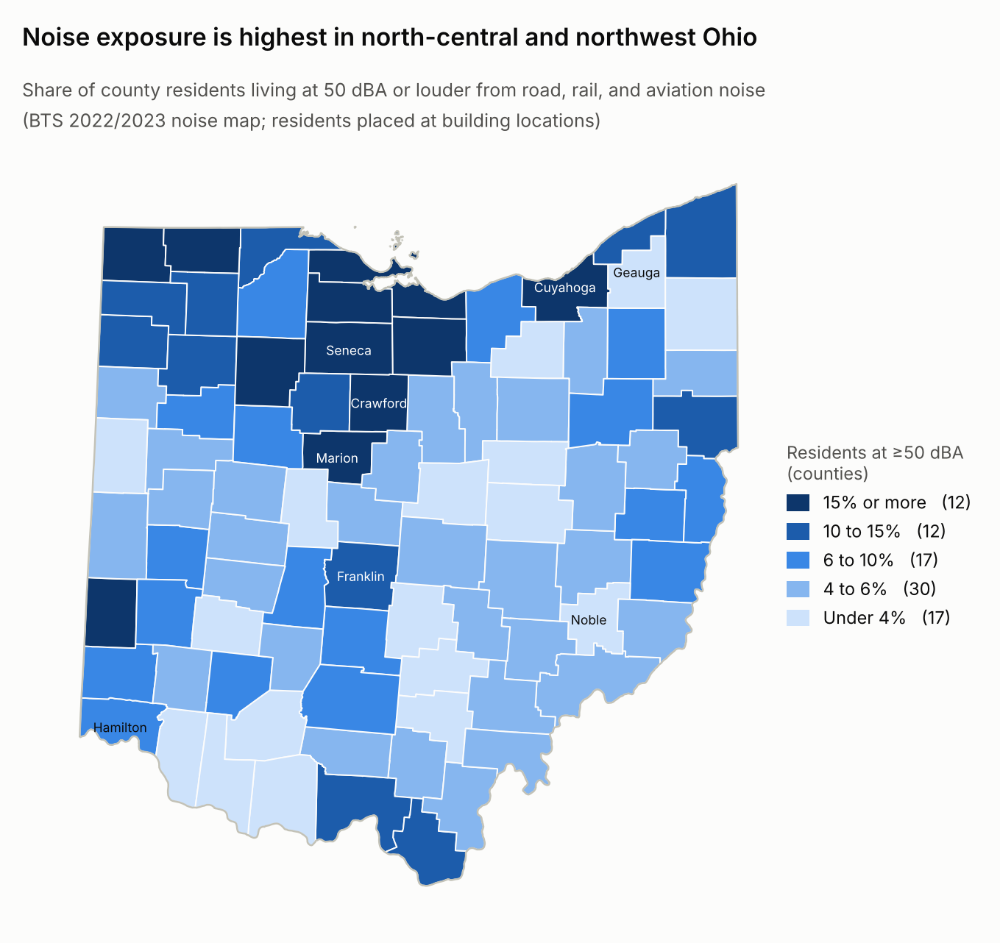
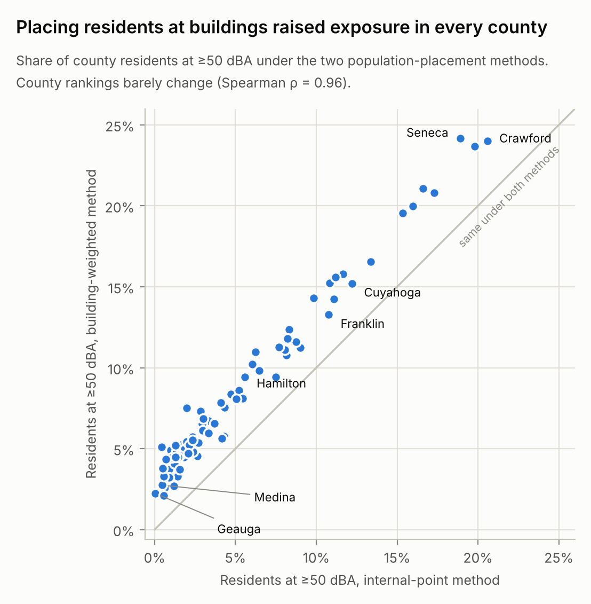
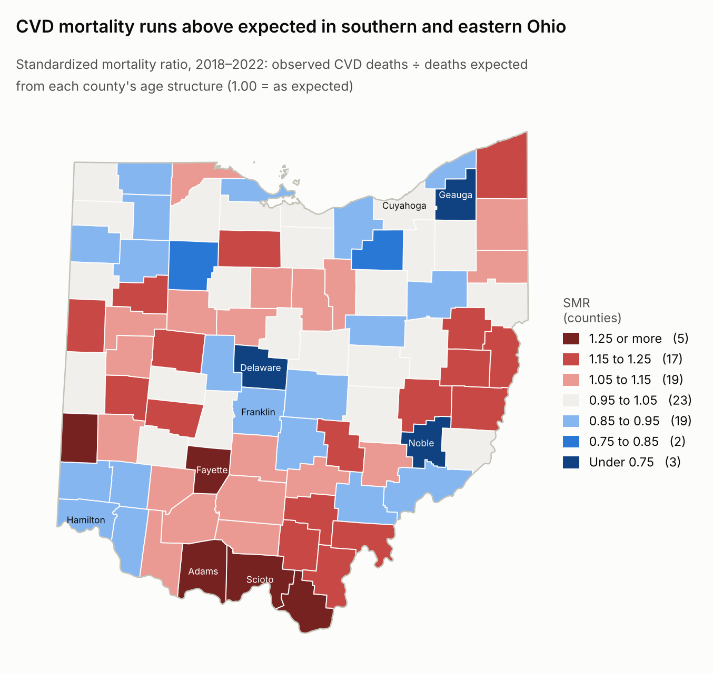
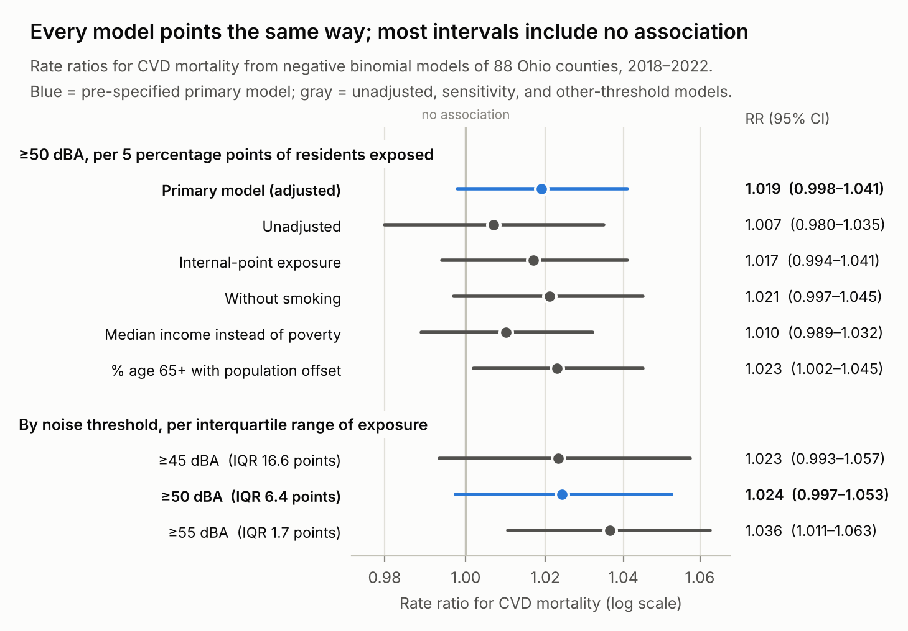

# Transportation Noise Exposure and Cardiovascular Mortality in Ohio Counties: An Ecological Study Using Public Data

**Andrew Moore** · November 2026

## Abstract

**Background.** Jin et al. (2024) linked long-term noise exposure to cardiovascular disease (CVD) mortality using geocoded death records from five U.S. states. Those records are restricted. This project asks whether the association is visible in public data alone.

**Methods.** I studied Ohio's 88 counties. CVD deaths for 2018–2022 (ICD-10 I00–I99; n = 198,052) came from CDC WONDER and were compared with the deaths expected from each county's age structure. Exposure was the share of residents living at or above 50 dBA of road, rail, and aviation noise in the 2022/2023 National Transportation Noise Map, with residents placed at 5.3 million building locations. Negative binomial models adjusted for urbanicity, poverty, race, smoking, and PM2.5. The analysis plan was fixed before any model was fit.

**Results.** Each additional 5 percentage points of residents at ≥50 dBA was associated with 1.9% higher age-adjusted CVD mortality (rate ratio 1.019, 95% CI 0.998–1.041). Estimates were positive in every sensitivity analysis (1.007–1.023) and somewhat larger at ≥55 dBA. A Poisson model, which ignores the overdispersion in county death counts, would have reported p = 0.001 instead of 0.074. Coronary heart disease prevalence from CDC PLACES showed no association, but that outcome is almost entirely determined by the covariates (R² = 0.975).

**Conclusion.** County-level public data show a positive but imprecise association between transportation noise and CVD mortality, consistent in direction with Jin et al. They cannot establish it. The project also documents three methodological points: how residents are placed within a county changes measured exposure, overdispersion must be modeled, and model-based prevalence estimates are poorly suited to studying environmental exposures.

## 1. Introduction

Noise has been linked to cardiovascular outcomes including hypertension, ischemic heart disease, and cardiovascular mortality, though findings are inconsistent, few studies come from the United States, and most consider only transportation noise [1]. The World Health Organization recommends keeping road traffic noise below 53 dB Lden [2].

Jin et al. [1] provided some of the first large-scale U.S. evidence. Using 936,019 CVD deaths geocoded to residential addresses in Indiana, Kansas, Missouri, Ohio, and Texas, they found that a 10 dBA higher day–night average sound level was associated with higher odds of CVD death relative to deaths from external causes (odds ratio 1.064, 95% CI 1.040–1.089). Associations were stronger in women and flattened above roughly 45–55 dBA.

That study has three features that limit how far others can build on it. Its death records were obtained from state health departments under data use agreements and cannot be shared. Its population was 86.3% White. And its exposure came from a single time-invariant sound model representing 2000–2014.

This project starts from a practical question: **how much of this can be examined with public data?** Public mortality data are available only for counties, so the design is ecological: it compares counties, not individuals. Within that constraint, the project uses a newer, transportation-specific noise map and measures exposure where people live within each county. Its aims are to estimate the county-level association between transportation noise and CVD mortality in Ohio, and to record what public data can and cannot support.

## 2. Data and methods

### 2.1 Design and setting

The study is a cross-sectional ecological analysis of Ohio's 88 counties. Ohio was one of the five states in Jin et al., it mixes large urban and small rural counties, and a pilot check showed that CDC WONDER suppresses none of its county CVD death counts, whether pooled over 2018–2022, split by year, or split by sex (notebook 01).

### 2.2 Outcome: CVD mortality

Deaths with an underlying cause in ICD-10 I00–I99, the definition used by Jin et al., were taken from CDC WONDER for 2018–2022 [3]: 198,052 deaths in total.

CVD death rates rise steeply with age. In Ohio the rate was 121 per 100,000 person-years at ages 45–54 and 6,066 at ages 85 and over, and people aged 85 and over accounted for about 2% of person-years but 38% of CVD deaths. To account for this, I calculated each county's **expected deaths** by indirect standardization: Ohio's death rate in each of ten age groups, multiplied by the county's population in that group from the American Community Survey (ACS) 2018–2022 [4], summed over groups. Statewide, expected deaths computed this way were within 0.07% of observed deaths, and they were rescaled to match exactly. Observed divided by expected deaths is the standardized mortality ratio (SMR).

### 2.3 Exposure: transportation noise

Noise levels came from the Bureau of Transportation Statistics (BTS) National Transportation Noise Map for 2022/2023 [5], which models road, rail, and aviation noise as a 24-hour equivalent sound level (LAeq, dBA) on a 30 m grid. I used 2022/2023 in preference to the 2020 map because the 2020 map reflects pandemic-reduced traffic.

BTS does not map levels below 45 dBA, so a county's average noise level cannot be computed without inventing values for quiet areas. The exposure measure is therefore the **share of county residents living at or above a threshold**, with unmapped areas counted as below it. Thresholds of 45, 50, and 55 dBA were chosen from the distribution of noise values before exposure was linked to any health outcome; a 65 dBA threshold was dropped because almost no residents were above it (under 0.1% in the median county).

Measuring that share requires placing residents within each county. I used two methods:

- **Internal points (notebook 03).** Each 2020 Census block's population [6] was assigned to the block's internal point (219,669 populated blocks).
- **Building-weighted (notebook 04, primary).** Each block's population was divided equally among the building footprints inside it, using Microsoft's US Building Footprints [7]. Of 5,544,032 Ohio footprints, those under 35 m² (1.8%), mostly sheds and garages, were dropped. The 2,403 populated blocks with no building (0.48% of the population) kept their internal point. This gave 5,349,093 population points.

### 2.4 Covariates

Covariates were limited to variables that plausibly affect both noise exposure and CVD: percent of residents in urban census blocks; percent below poverty and percent non-Hispanic Black (ACS 2018–2022); age-adjusted current smoking (CDC PLACES [8]); and PM2.5, averaged over 2018–2022 from the Washington University satellite-derived product [9] and weighted by the same population points as noise. High blood pressure and short sleep were excluded because they lie on the causal path from noise to CVD. With 88 counties, the model was limited to about six to eight predictors, so one socioeconomic measure was chosen: poverty, which was least correlated with urbanicity (r = −0.09) and smoking (r = 0.72). All variance inflation factors were below 5 (noise: 1.11; smoking, the highest: 4.50).

### 2.5 Statistical analysis

The analysis plan was written in the notebook and the Decision Log before any model was fit.

- **Primary model.** Negative binomial regression of death counts with log(expected deaths) as the offset, so that coefficients are rate ratios (RR) for age-adjusted mortality. A Poisson model was fit first to test for overdispersion.
- **Primary exposure.** Share of residents at ≥50 dBA, building-weighted, reported per 5 percentage points. Lden penalizes evening and night noise, so it runs a few decibels above a 24-hour LAeq; a 50 dBA LAeq threshold is therefore in the region of the WHO guideline, though not equivalent to it. This threshold also varied enough across counties and was robust to the population-placement method.
- **Secondary analyses.** The ≥45 and ≥55 dBA thresholds, compared per interquartile range (IQR) because the thresholds have very different spreads; and coronary heart disease (CHD) prevalence as a second outcome.
- **Sensitivity analyses.** Internal-point exposure; omitting smoking; median household income in place of poverty; and percent aged 65 and over with a population offset in place of expected deaths.
- **Diagnostics.** Spatial autocorrelation of residuals was tested with Moran's I (queen contiguity, 999 permutations).

Negative binomial models were fit by maximum likelihood (BFGS initialization, Newton refinement), and convergence was confirmed for every model. CHD prevalence, a percentage, was modeled by linear regression on its logarithm with HC3 robust standard errors, giving prevalence ratios (PR). Analyses used Python (pandas, geopandas, rasterio, statsmodels, esda).

## 3. Results

### 3.1 Noise exposure

Statewide, 23.6% of Ohio residents lived at ≥45 dBA, 9.1% at ≥50 dBA, and 2.5% at ≥55 dBA. The share at ≥50 dBA ranged from 2.1% to 24.2% across counties (Table 1, Figure 1). The most exposed counties were not the largest cities but small counties in north-central Ohio: Seneca (24.2%), Crawford (24.0%), and Marion (23.7%), compared with Cuyahoga (15.2%), Franklin (13.3%), and Hamilton (9.4%). The most exposed counties contain railroad junction towns, and the BTS model adds train-horn noise within a quarter mile of grade crossings [5]; this explanation has not yet been tested against the rail-only layer.

**Figure 1.** Share of county residents living at ≥50 dBA of transportation noise (building-weighted).

**Population placement.** The internal-point method undercounted exposure in exurban counties. In Geauga County, 0.1% of residents but about 6% of land was at ≥45 dBA (the land share is approximate, from a rectangle around the county): block internal points fell mid-block, away from the roadside homes where rural residents live. Placing residents at buildings raised exposure in all 88 counties (at ≥45 dBA: Geauga 0.1% → 4.7%, Medina 1.9% → 6.8%). County rankings were nearly unchanged at 45 and 50 dBA (Spearman ρ = 0.98 and 0.96) and less stable at 55 dBA (ρ = 0.85) (Figure 2).

**Figure 2.** Share of residents at ≥50 dBA under the internal-point and building-weighted methods. Each point is a county.

**Table 1.** Characteristics of Ohio counties (n = 88).

| Characteristic | Median | IQR | Range |
|---|---|---|---|
| CVD deaths, 2018–2022 | 1,037 | 638 to 2,124 | 216 to 23,507 |
| Standardized mortality ratio | 1.03 | 0.94 to 1.15 | 0.62 to 1.38 |
| Residents at ≥45 dBA (%) | 15.4 | 9.1 to 25.6 | 4.1 to 54.6 |
| Residents at ≥50 dBA (%) | 5.7 | 4.5 to 10.8 | 2.1 to 24.2 |
| Residents at ≥55 dBA (%) | 2.0 | 1.4 to 3.2 | 0.3 to 7.7 |
| Urban population (%) | 44.6 | 28.4 to 66.8 | 0.0 to 99.4 |
| Below poverty (%) | 12.9 | 10.1 to 16.1 | 4.5 to 24.4 |
| Non-Hispanic Black (%) | 1.9 | 0.9 to 4.5 | 0.1 to 28.7 |
| Current smoking, age-adjusted (%) | 17.6 | 15.6 to 19.4 | 9.9 to 23.3 |
| PM2.5, 2018–2022 mean (µg/m³) | 7.41 | 7.17 to 7.80 | 6.27 to 9.30 |
| CHD prevalence, age-adjusted (%) | 6.2 | 5.7 to 6.6 | 4.4 to 7.7 |

### 3.2 CVD mortality

County SMRs ranged from 0.62 to 1.38 and were spatially clustered (Moran's I = 0.236, p = 0.002), with higher mortality in southern and eastern Ohio (Figure 3).

**Figure 3.** Standardized mortality ratio for CVD, 2018–2022.

### 3.3 Noise and CVD mortality

County death counts were strongly overdispersed (Poisson dispersion statistic 15.4), so the negative binomial model was used as planned. Each additional 5 percentage points of residents at ≥50 dBA was associated with a 1.9% higher age-adjusted CVD mortality rate (**RR 1.019, 95% CI 0.998–1.041, p = 0.074**). Across the IQR of exposure (6.4 points), the rate ratio was 1.024 (0.997–1.053). The Poisson model gave a narrower interval and a much smaller p-value for the same exposure (RR 1.009, 95% CI 1.004–1.014, p = 0.001).

Table 2 and Figure 4 show the other models. Every estimate at ≥50 dBA was above 1, from 1.007 to 1.023. Adjustment increased the estimate (unadjusted 1.007). Results changed little with internal-point exposure, without smoking, or with the alternative age adjustment; replacing poverty with median income roughly halved the estimate (1.010). Per IQR, estimates were similar at 45 and 50 dBA and somewhat larger at 55 dBA, where the interval excluded 1, but the three intervals overlap substantially.

**Table 2.** Rate ratios for CVD mortality by share of residents exposed to noise.

| Model | RR | 95% CI | p |
|---|---|---|---|
| *≥50 dBA, per 5 percentage points* | | | |
| **Primary (adjusted)** | **1.019** | **0.998–1.041** | **0.074** |
| Unadjusted | 1.007 | 0.980–1.035 | 0.593 |
| Internal-point exposure | 1.017 | 0.994–1.041 | 0.140 |
| Without smoking | 1.021 | 0.997–1.045 | 0.084 |
| Median income instead of poverty | 1.010 | 0.989–1.032 | 0.343 |
| % aged 65+ with population offset | 1.023 | 1.002–1.045 | 0.035 |
| *By threshold, per IQR* | | | |
| ≥45 dBA (16.6 points) | 1.023 | 0.993–1.057 | 0.129 |
| ≥50 dBA (6.4 points) | 1.024 | 0.997–1.053 | 0.074 |
| ≥55 dBA (1.7 points) | 1.036 | 1.011–1.063 | 0.005 |

**Figure 4.** Rate ratios for CVD mortality across models.

Residuals from the primary model showed little spatial autocorrelation (Moran's I = 0.058, p = 0.133), so no spatial correction was applied.

### 3.4 CHD prevalence

CHD prevalence was not associated with noise exposure (PR 1.002 per 5 percentage points at ≥50 dBA, 95% CI 0.998–1.005, p = 0.30), and results were similar at the other thresholds, unadjusted, and with population weighting (PR 0.992 to 1.003). The model explained 97.5% of the county variation in CHD prevalence.

## 4. Discussion

### 4.1 Main finding

Across Ohio counties, greater transportation noise exposure was associated with modestly higher age-adjusted CVD mortality. The direction was the same in every specification. The size was imprecise: the primary confidence interval runs from a 0.2% decrease to a 4.1% increase per 5 percentage points, so the data are compatible with no association.

This agrees in direction with Jin et al. [1], but the two estimates cannot be compared in size. Theirs is an individual-level odds ratio per 10 dBA; this one is a county-level rate ratio per share of residents above a threshold, from a different noise model. A comparison of the two national noise models found BTS levels about 6 dBA higher on average than the model Jin et al. used [11], so thresholds do not carry over either. With 88 units of analysis, an ecological study also has far less power than one with over a million death records.

### 4.2 What else the project showed

**Population placement changes measured exposure.** A whole block assigned to one point misses roadside homes in large rural blocks. Building-level placement corrected this, and it raised exposure everywhere without reordering counties much, which is why the internal-point sensitivity analysis gave a similar rate ratio. A national exposure map built from the 2020 BTS data assumes that the share of a block group's population exposed equals the share of its area exposed [10]; the building-based approach here is finer.

**Overdispersion decides the conclusion.** The Poisson model's p-value of 0.001 came from assuming that death counts vary only by chance. County mortality varied about 15 times more than that. The two models also gave different point estimates because Poisson weights the largest counties most heavily; the larger negative binomial estimate suggests the association may be stronger across smaller counties, which would fit the high exposure in small rail towns, but this was not tested.

**Model-based prevalence could not test the question.** PLACES estimates CHD prevalence partly from demographic information, and the smoking covariate comes from the same system. With 97.5% of its variation explained by the covariates, the CHD outcome had almost no room to show an association with an exposure that PLACES does not model. The null result, and its narrow interval, more likely reflect this than evidence that noise is unrelated to CHD.

### 4.3 Limitations

- **Ecological design.** County-level associations do not show that the residents exposed to noise are the ones who died of CVD.
- **Power.** Eighty-eight counties allow only modest precision.
- **Exposure model.** BTS models interstates, arterials, and major collectors but not local streets, and it assigns low default speeds (about 20 mph) to urban arterials that lack speed data; both would understate exposure, probably more in cities. It also ignores shielding by barriers, buildings, and terrain, which works in the other direction. BTS states that the map is intended for tracking trends, not for evaluating individual locations [5].
- **Timing.** The noise map (2022/2023) falls at the end of the mortality period (2018–2022). The analysis assumes that where noise is loud changes slowly because it follows highways, rail lines, and airports.
- **Population placement.** Building footprints include non-residential buildings, each block's population was split equally among its buildings, and footprint imagery dates vary.
- **Confounding.** The estimate was sensitive to the socioeconomic measure. PLACES smoking is model-based and correlated with socioeconomic status. Unmeasured county differences, such as access to health care, may remain.
- **Multiple analyses.** The primary analysis was pre-specified. The secondary and sensitivity results, including the two intervals that exclude 1, were not adjusted for multiple comparisons and should be read as supporting evidence.
- **Spatial dependence.** Little residual clustering was detected, but with 88 counties weak clustering cannot be ruled out.
- **One state.** Results may not generalize beyond Ohio.

### 4.4 Next steps

1. Repeat the exposure calculation with the separate road, rail, and aviation layers, to test the rail explanation and estimate source-specific associations.
2. Repeat it with the 2020 noise map to check sensitivity to the noise year.
3. Check whether individual counties drive the result (the lowest-exposure county, Noble, also has the lowest SMR).
4. Add states, which would increase power and population diversity but brings back suppressed death counts in small counties.

## 5. Conclusion

Public county-level data show a positive, consistent, but imprecise association between transportation noise exposure and CVD mortality in Ohio. They are enough to raise the question that Jin et al. answered with restricted records, and not enough to settle it.

## Data and code availability

All code is in the project repository (`notebooks/01` to `09`). County-level data files are in `data/processed/`; the large public source files are listed with download instructions in `data/README.md`. Every analysis decision, with its date and rationale, is recorded in the Decision Log tab of `Noise_CVD_Data_Inventory.xlsx`.

## References

1. Jin T, Kosheleva A, Castro E, Qiu X, James P, Schwartz J. Long-term noise exposures and cardiovascular diseases mortality: A study in 5 U.S. states. *Environmental Research*. 2024;245:118092. <https://doi.org/10.1016/j.envres.2023.118092>
2. World Health Organization Regional Office for Europe. *Environmental Noise Guidelines for the European Region*. Copenhagen: WHO; 2018.
3. Centers for Disease Control and Prevention, National Center for Health Statistics. Underlying Cause of Death, 2018–2024, Single Race. CDC WONDER Online Database. <https://wonder.cdc.gov>
4. U.S. Census Bureau. American Community Survey 5-Year Estimates, 2018–2022. <https://www.census.gov/programs-surveys/acs>
5. U.S. Department of Transportation, Bureau of Transportation Statistics. National Transportation Noise Map, 2022/2023. <https://www.bts.gov/geospatial/national-transportation-noise-map>. Methods: *National Transportation Noise Map Documentation*, Version 3. Volpe National Transportation Systems Center. <https://rosap.ntl.bts.gov/view/dot/90910>
6. U.S. Census Bureau. TIGER/Line Shapefiles, 2022: 2020 Census Blocks, Ohio. <https://www.census.gov/geographies/mapping-files/time-series/geo/tiger-line-file.html>
7. Microsoft. US Building Footprints. <https://github.com/microsoft/USBuildingFootprints>
8. Centers for Disease Control and Prevention. PLACES: Local Data for Better Health, County Data, 2025 release. <https://data.cdc.gov/d/swc5-untb>
9. Shen S, Li C, van Donkelaar A, Jacobs N, Wang C, Martin RV. Enhancing global estimation of fine particulate matter concentrations by including geophysical a priori information in deep learning. ACS ES&T Air. 2024;1(5):332–345. https://doi.org/10.1021/acsestair.3c00054. Data: Atmospheric Composition Analysis Group, Washington University in St. Louis, V6.GL.02.04. https://sites.wustl.edu/acag/datasets/surface-pm2-5
10. Seto E, Huang CH. The National Transportation Noise Exposure Map. *medRxiv*. 2023. <https://doi.org/10.1101/2023.02.02.23285396>
11. Huang CHS, Seto E. Comparison of two national noise models: Progress towards an integrated noise model for environmental health research in the United States. medRxiv. 2025. https://doi.org/10.1101/2025.09.23.25336495
